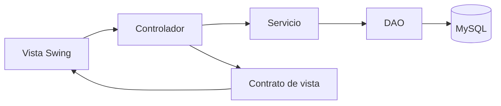

Estado actualizado: ver revision-general.md para el alcance actual de toda la aplicacion.

# Paquete controlador

Se crearon los trece controladores descritos en la seccion 7 de la guia. Reciben interfaces de vista y servicios; no importan DAO, JDBC ni conexionDB. Cada bloque tiene comentarios sobre su funcion.

## Controladores

| Clase | Acciones |
| --- | --- |
| LoginControlador | Recoge credenciales, limpia la copia de caracteres, autentica y solicita el menu del usuario. |
| PrincipalControlador | Actualiza semaforo, comprueba permisos de navegacion y cierra sesion cancelando el carrito. |
| VentaControlador | Busca, inicia carrito, agrega, reduce, quita, cobra y cancela. |
| CompraGastoControlador | Prepara lineas, guarda compra, registra gasto y consulta los movimientos del dia. |
| BalanceControlador | Carga una fecha y exporta el balance que quedo presentado. |
| MargenControlador | Carga ranking y presenta consejos del analizador. |
| HistorialControlador | Lista y filtra evidencia sin editarla. |
| ModificarVentaControlador | Busca venta y envia total y motivo al servicio. |
| CierreControlador | Presenta efectivo esperado, envia conteo y muestra el cierre. |
| UsuarioControlador | Crear, editar, desactivar, listar y restablecer clave. |
| ProductoControlador | Crear, editar catalogo, desactivar y listar incluidos los inactivos. |
| CostoFijoControlador | Crear, editar, desactivar y listar costos. |
| ConfiguracionControlador | Cargar y guardar Negocio. |

ControladorBase comparte conversiones de campos, mensajes, estado ocupado y ejecucion. AplicacionControladores construye los controladores con una misma instancia de ServiciosAplicacion y una misma cola de tareas.

## MVC y contratos de vista

El flujo es:



Las interfaces estan en vista.contratos. VistaBase permite registrar acciones, mostrar mensajes y bloquear controles. Cada VistaLogin, VistaVenta y demas contrato agrega los campos y resultados necesarios para su pantalla. AccionVista identifica los eventos sin conocer los nombres privados de los botones Swing.

Esto demuestra abstraccion, interfaces, encapsulacion, herencia y composicion. Los tipos de entrada se convierten en el controlador, pero las reglas de negocio permanecen en servicios y las validaciones de entidad en el modelo.

## Estado de las ventanas

Main inicia AplicacionDesktop, que crea y conecta las ventanas Swing concretas con los controladores. FrmLogin ya autentica de verdad. Se agregaron las demas pantallas de la guia, un formulario de primer uso y los componentes reutilizables FrmBase, PanelSemaforo y PanelGrafica.

Navegacion se implementa en AplicacionDesktop. Los botones se conectan una sola vez. Las escrituras correctas notifican a la pantalla principal para refrescar el semaforo; cerrar una sesion descarta el carrito para que otra persona no lo herede.

El primer uso tiene su propio InicializacionControlador. No introduce registro publico de usuarios: solo funciona cuando no hay cuentas y guarda administrador y negocio atomicamente.
## Conexion de botones

Cada implementacion registra su boton en alAccionar. Por ejemplo, al implementar el contrato de una vista:

```java
@Override
public void alAccionar(AccionVista accion, Runnable manejador) {
    if (accion == AccionVista.INGRESAR) {
        btnIngresar.addActionListener(evento -> manejador.run());
    } else {
        throw new IllegalArgumentException("Accion no soportada por el login");
    }
}
```

getUsername devuelve el texto del usuario y getContrasena devuelve la copia de JPasswordField.getPassword. limpiarContrasena vacia el campo. setOcupada deshabilita los controles editables y botones durante la operacion. Los metodos mostrar presentan los resultados sin calcular precios, margenes ni diferencias.

La vista de administracion de usuarios debe mostrar columnas publicas como id, nombre, username, rol, activo y fecha; nunca passwordHash.

Crear una sola instancia de ServiciosAplicacion y AplicacionControladores al arrancar. Con cada vista nueva, llamar al correspondiente crearLogin, crearVenta u otro metodo de AplicacionControladores una sola vez. El resultado debe conservarse mientras viva esa ventana.

## Trabajo fuera del hilo de Swing

EjecutorSwing utiliza Executors.newSingleThreadExecutor, del JDK. Cada tarea se ejecuta fuera del EDT y los resultados vuelven mediante SwingUtilities.invokeLater. La cola unica evita operaciones JDBC simultaneas sobre la conexion compartida y conserva el orden de envio.

La vista se lee antes de encolar, en su propio hilo. No se consultan JTextField, tablas o selectores desde el trabajo de fondo. Un segundo clic mientras la operacion esta pendiente no crea otra escritura.

No se debe crear un EjecutorSwing por controlador. AplicacionControladores comparte uno entre todos. Al salir de la aplicacion se llama a close para dejar terminar el trabajo aceptado y cerrar la cola. No se utiliza shutdownNow para no interrumpir una transaccion.

Al cerrar una ventana individual se llama a desvincular en su controlador antes de destruirla. Una respuesta tardia no actualiza componentes de una ventana destruida. Desvincular no cancela una escritura ya iniciada: el servicio debe terminarla o revertirla.

En las pruebas se inyecta un EjecutorTareas inmediato, sin hilos, y se comprueba por separado que el ejecutor Swing real procesa tareas en serie y entrega callbacks en el EDT.

## Conversion de campos y errores

- Los importes aceptan coma o punto decimal, por ejemplo 1000,50 o 1000.50. Se rechazan separadores de miles ambiguos como 1.000,50.
- Cantidades e identificadores se convierten a enteros; una seleccion ausente produce un mensaje y no ejecuta el servicio.
- Las fechas utilizan AAAA-MM-DD y las horas formatos como 08:30.
- Las claves no se conservan en atributos ni se imprimen. La copia char[] se rellena con ceros y se limpia la vista; el servicio existente recibe un String para autenticar.
- Los errores de negocio y validacion se presentan al usuario. Los errores JDBC se convierten en un mensaje generico sin sentencias ni credenciales; los errores tecnicos inesperados tampoco exponen su texto.
- Una operacion solo anuncia exito despues de recibir la respuesta del servicio. Los controles se restauran tanto al acertar como al fallar.
- Si falla la carga de balance, se invalida el resultado anterior antes de permitir una exportacion. Cancelar el selector de archivo no intenta guardar.

El controlador no modifica inventario. VentaDAO y CompraDAO realizan los movimientos una sola vez a traves de los servicios. El controlador de compra solo conserva el borrador de su ventana y verifica que no cambie su propietario al cambiar de sesion.

## Ajustes puntuales de servicios

Se agregaron dos metodos para evitar que los controladores consulten DAO directamente:

- ServicioVentas.buscarVenta: exige MODIFICAR_VENTA, devuelve la venta o informa que no existe.
- ServicioProductos.listarProductos: exige GESTIONAR_PRODUCTOS e incluye registros desactivados para la tabla administrativa.

Ambos permisos tambien se probaron con el perfil cajero. No se agregaron dependencias al POM, otra conexion ni otro Singleton.

## Pruebas

```powershell
# Pruebas de presentacion sin abrir ventanas ni usar MySQL:
powershell -NoProfile -ExecutionPolicy Bypass -File scripts/probar-controlador.ps1 -SoloUnitarias

# Agrega un recorrido completo con servicios y DAO reales en una base temporal:
powershell -NoProfile -ExecutionPolicy Bypass -File scripts/probar-controlador.ps1
```

Resultado: 28 pruebas unitarias y 18 pruebas MySQL correctas, cero fallidas. El proceso real crea un esquema temporal, lo elimina al terminar y conserva intacta la base original.

Los casos cubren los trece controladores, registro de listeners, navegacion por permisos, errores de acceso a datos, limpieza de claves, conversion de importes y fechas, selecciones ausentes, doble clic, respuestas tardias, callbacks en el EDT, stock, balance del ejemplo, CSV real, compras, gastos, historial, ajuste de venta y cierre de caja. Se compilo todo el codigo Java existente junto con el nuevo paquete.

Las pruebas no abren JFrame y no equivalen a una verificacion visual de ventanas. Siguen usando mains de Java, sin JUnit ni librerias externas adicionales. El POM y todos los scripts compilan con nivel Java 17; la verificacion se ejecuto con el JDK disponible, 26.0.1.
