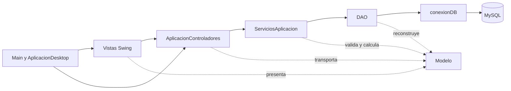
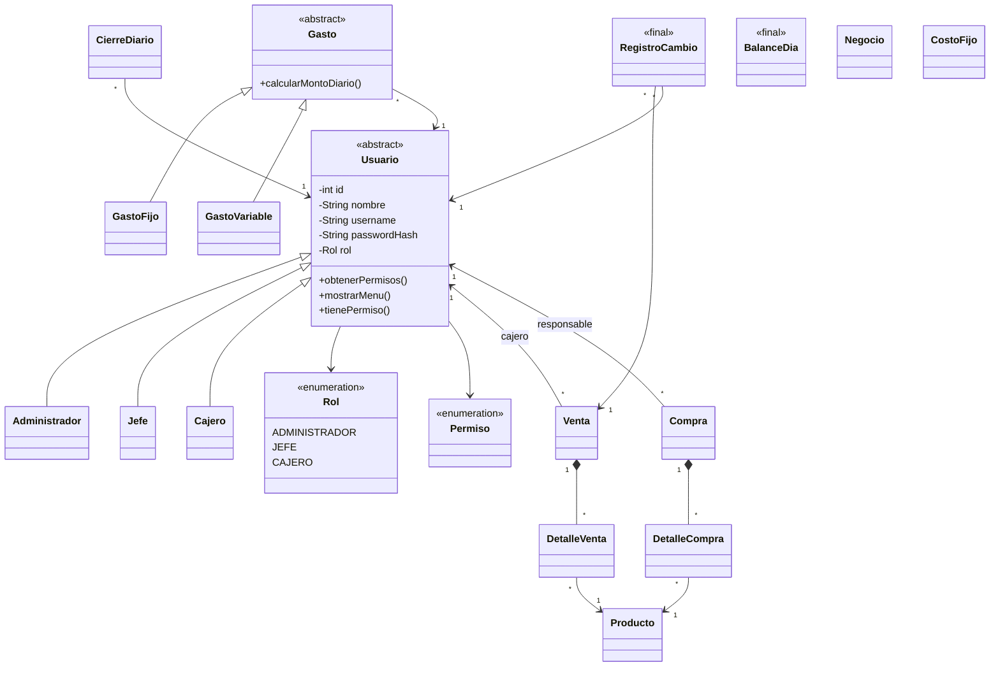
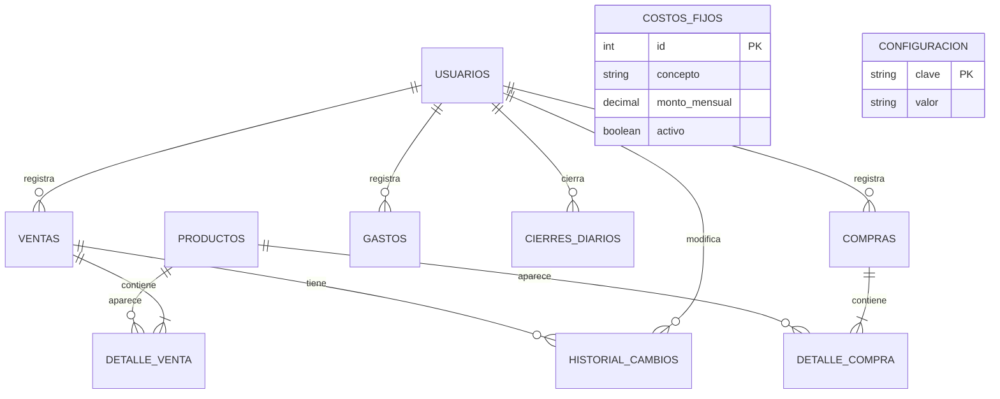

# Diseno del proyecto

Estos diagramas representan el codigo actual. La conexion se conserva en conexion.conexionDB para evitar duplicar el Singleton existente.

## Capas y responsabilidades

Main es el inicio. AplicacionDesktop construye y enlaza objetos. Esa composicion no es otra conexion ni otra capa de reglas financieras.

## Relaciones del modelo

Los detalles copian los precios y costos historicos. RegistroCambio congela sus valores, fecha y motivo; sus referencias a venta y usuario son asociaciones. BalanceDia transporta cifras e indicadores de meta calculable o estimada.

## Relacion de las tablas

La estructura concreta esta en sql/esquema.sql. Los detalles de una venta son unicos por venta y producto. username y fecha de cierre tienen restricciones unicas.

## Conceptos de POO que debe explicar el grupo

| Concepto | Ejemplo del codigo |
| --- | --- |
| Encapsulacion | Atributos privados y validaciones de Producto y Usuario. |
| Herencia | Cajero, Jefe y Administrador heredan de Usuario. |
| Abstraccion | Usuario y Gasto no se instancian directamente. |
| Polimorfismo | Cada Gasto calcula su importe diario de forma distinta; los estados del semaforo tienen mensajes distintos. |
| Interfaces | CrudDAO, EstadoNegocio, Exportable y los contratos de vista. |
| Composicion | ServiciosAplicacion y AplicacionControladores reciben y comparten objetos. |
| Excepciones | Stock insuficiente, permiso denegado y dia cerrado comunican fallos de negocio. |
| Genericos | CrudDAO<T> y DAOBase<T> reutilizan operaciones para distintas entidades. |
| Singleton | Sesion y conexionDB tienen propositos distintos; hay un solo administrador de conexion. |

## Cuatro ayudas de Java que conviene estudiar

BigDecimal evita errores de dinero; no es una libreria externa. Las expresiones con -> son acciones cortas que se entregan a botones o tareas. La cola de EjecutorSwing evita bloquear la interfaz y usar JDBC simultaneamente. PBKDF2 es el mecanismo del JDK para guardar hashes de claves: el grupo utiliza la API, no inventa criptografia.

Estas ayudas estan aisladas y comentadas. El resto del trabajo se expresa mediante objetos, metodos, listas, condicionales, ciclos y JDBC.
